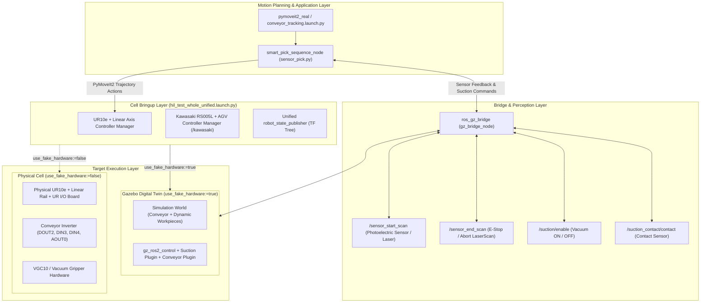

# 🤖 IFARLAB Digital Twin & HIL Robotic Conveyor Tracking System


## 📌 Overview

This repository contains the industrial-grade **Digital Twin** and **Hardware-in-the-Loop (HIL)** robotic testbed developed at the **Intelligent Factory and Robotics Laboratory (IFARLAB)** of **Eskişehir Osmangazi University (ESOGU)**.

The system provides bi-directional synchronization between a physical dual-robot manufacturing cell and its high-fidelity Gazebo simulation twin:
* **Digital Twin Validation:** Enables risk-free testing of conveyor tracking, dynamic part interception, sensor fusion, and high-speed pick-and-place trajectories in Gazebo prior to hardware deployment.
* **Hardware-in-the-Loop (HIL):** Trajectories and sensor feedback can seamlessly transition between real hardware (UR10e on a 7th-axis linear rail, Kawasaki RS005L, AGV, industrial conveyor line, and vacuum gripper) and simulated components in real-time.

---

## 🏛️ System Architecture



---

## ⚠️ Important Setup Step: Updating File Paths

> [!WARNING]
> The current URDF/Xacro models use absolute file paths for certain custom CAD meshes (such as the linear rail). To run this repository on your machine without path errors, you **must** update these paths to match your Linux username and workspace directory.

**TODO:** Before building or launching the system, update the absolute paths in the `.xacro` files.

For example, in `firstrobot_my_robot_cell_macro.xacro` (located inside the `my_robot_cell_description` package, around line 83):

```xml
<!-- Original path in the repository: -->
<mesh filename="file:////home/emirhan/colcon_ws/src/Universal_Robots_ROS2_Description/meshes/ur10e/collision/linear_axis_moving_link.stl" scale="0.001 0.001 0.001"/>
```

You must replace the `/home/emirhan/` part with your own username (for example, if your username is `ifarlab`):

```xml
<!-- Updated path for your system: -->
<mesh filename="file:////home/ifarlab/colcon_ws/src/Universal_Robots_ROS2_Description/meshes/ur10e/collision/linear_axis_moving_link.stl" scale="0.001 0.001 0.001"/>
```

---

## 🚀 Installation & Build

Ensure you have ROS 2 (Humble recommended) and Gazebo Sim installed. Then install dependencies and build the workspace:

```bash
cd ~/colcon_ws
rosdep update
rosdep install --from-paths src -y --ignore-src
colcon build --symlink-install
source install/setup.bash
```

---

## ⚡ Quick Start / Running the System

The complete Digital Twin & Conveyor Tracking pipeline runs with **two main launch commands**:

### Step 1: Launch the Robotic Cell & Digital Twin Environment
Bring up the unified URDF model, controllers, and Gazebo simulation:

```bash
ros2 launch my_robot_cell_control hil_test_whole_unified.launch.py use_vacuum_gripper:=true use_fake_hardware:=true
```

#### Launch Arguments Breakdown:
* `use_vacuum_gripper:=true`: Attaches and activates the **vacuum / suction gripper** end-effector on the UR10e instead of the standard two-finger gripper.
* `use_fake_hardware:=true`: Configures ROS 2 Control to use mock/simulation hardware interfaces running inside **Gazebo Sim**.
  > **Note:** Set `use_fake_hardware:=false` when connecting to the physical UR10e robot controller and real cell hardware in the laboratory.

---

### Step 2: Start Conveyor Tracking & Sensor-Guided Pick
Once the cell and simulation environment are fully initialized, open a new terminal and run:

```bash
ros2 launch pymoveit2_real conveyor_tracking.launch.py
```

#### What This Node Executes:
1. **Perception & Control Bridge (`gz_bridge_node`):** Bridges the conveyor entry sensor (`/sensor_start_scan`), safety abort sensor (`/sensor_end_scan`), vacuum activation (`/suction/enable`), and physical contact feedback (`/suction_contact/contact`) between Gazebo and ROS 2.
2. **Dynamic Pick-and-Place Sequencer (`sensor_pick.py`):**
   * Uses **PyMoveIt2** to coordinate the UR10e arm and 7th-axis linear rail.
   * Dynamically tracks incoming workpieces on the active conveyor belt.
   * Intercepts the part, activates vacuum suction, verifies grip via contact sensor, and transfers the item to the designated placement target.

---

## 🔌 Hardware & Signal I/O Mapping

The system maps simulation topics directly to physical robot I/O pins for seamless HIL operation:

| Signal Name | Physical Pin / ROS 2 Topic | Description |
| :--- | :--- | :--- |
| **Conveyor Forward** | `DOUT2` (Digital Output) | Triggers conveyor belt drive forward via inverter |
| **Sensor Start** | `DIN3` / `/sensor_start_scan` | Entry photoelectric sensor (workpiece detected) |
| **Sensor End** | `DIN4` / `/sensor_end_scan` | Exit photocell (boundary / pick abort trigger) |
| **Conveyor Speed** | `AOUT0` (Analog Output) | Voltage reference controlling conveyor belt velocity |
| **Suction Enable** | `/suction/enable` | Command signal activating/deactivating vacuum gripper |
| **Suction Contact** | `suction_contact/contact` | Verifies physical grip between cup and workpiece |

---

## 🏢 Laboratory & Attribution

Developed by the **Intelligent Factory and Robotics Laboratory (IFARLAB)**  
Department of Mechanical & Mechatronics Engineering, **Eskişehir Osmangazi University (ESOGU)**.
